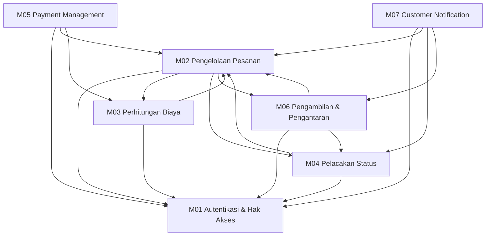

# D2 — Module Breakdown

Lavora dipecah menjadi **7 modul**. Setiap modul punya satu tanggung jawab utama, dan fitur-fitur di dalamnya dikelompokkan karena melayani tujuan yang sama. Dokumen ini merangkum semuanya dalam satu tempat; penjelasan rinci tiap modul ada di folder [`modules/`](modules/).

> Catatan: pembagian menjadi 7 modul telah disetujui oleh dosen pengampu.

## 1. Ringkasan Modul

| ID | Modul | Tanggung jawab | Detail |
|---|---|---|---|
| M01 | Autentikasi dan Pengaturan Hak Akses | Memverifikasi identitas pengguna dan mengatur hak akses berdasarkan peran, termasuk persetujuan akun staf oleh pemilik. | [file](modules/01-authentication-access-control.md) |
| M02 | Pengelolaan Pesanan | Mengelola pesanan laundry dari pembuatan hingga penyimpanan detail layanan dan pakaian yang akan dicuci. | [file](modules/02-order-management.md) |
| M03 | Perhitungan Harga dan Biaya | Menghitung biaya layanan berdasarkan berat aktual cucian dan tarif per kilogram yang ditetapkan pemilik. | [file](modules/03-pricing-cost-calculation.md) |
| M04 | Pelacakan Status Laundry | Mengelola dan menyimpan status pengerjaan pesanan agar perkembangan cucian dapat dipantau sesuai hak akses. | [file](modules/04-laundry-status-tracking.md) |
| M05 | Payment Management | Mengelola metode dan status pembayaran layanan, baik online (konseptual) maupun offline. | [file](modules/05-payment-management.md) |
| M06 | Pengelolaan Pengambilan dan Pengantaran | Mencatat metode penyerahan laundry yang dipilih pelanggan serta informasi yang dibutuhkan untuk proses penyerahan. | [file](modules/06-pickup-delivery-management.md) |
| M07 | Customer Notification | Memberi tahu pelanggan mengenai perubahan status pesanan melalui mekanisme di dalam sistem. | [file](modules/07-customer-notification.md) |

## 2. Tanggung Jawab dan Fitur Utama

### M01 — Autentikasi dan Pengaturan Hak Akses

Modul ini bertanggung jawab memverifikasi identitas pengguna dan membatasi akses fitur sesuai peran (Pelanggan, Staf, Pemilik). Modul ini menjadi pintu masuk seluruh sistem, sehingga modul lain bergantung padanya untuk memastikan hanya pengguna berhak yang dapat menjalankan suatu aksi.

- Pendaftaran akun pelanggan secara mandiri.
- Masuk dan keluar sistem.
- Persetujuan akun staf oleh pemilik sebelum memperoleh hak akses staf.
- Pembatasan akses fitur berdasarkan peran pengguna.

### M02 — Pengelolaan Pesanan

Modul ini bertanggung jawab mengelola pesanan laundry pelanggan, mulai dari pembuatan hingga penyimpanan detail layanan dan pakaian yang akan dicuci. Modul ini menjadi pusat data pesanan yang dirujuk modul lain.

- Pembuatan pesanan oleh pelanggan.
- Penyimpanan detail layanan, informasi pakaian, dan catatan khusus.
- Melihat detail dan riwayat pesanan sesuai hak akses.
- Pengelolaan dan pembaruan detail pesanan oleh staf.

### M03 — Perhitungan Harga dan Biaya

Modul ini bertanggung jawab menghitung biaya layanan berdasarkan berat aktual cucian dan tarif per kilogram yang ditetapkan pemilik. Pengaturan tarif dan perhitungan biaya digabung karena keduanya langsung menentukan harga pesanan.

- Pengaturan tarif layanan per kilogram oleh pemilik.
- Penginputan berat aktual cucian oleh staf setelah cucian ditimbang.
- Perhitungan total biaya: **berat aktual × tarif per kilogram**.
- Penyajian informasi biaya pesanan kepada pelanggan.

### M04 — Pelacakan Status Laundry

Modul ini bertanggung jawab mengelola dan menyimpan status pengerjaan pesanan agar pelanggan dapat memantau perkembangan cuciannya. Pembaruan status dan pemantauan digabung karena keduanya menyangkut penyampaian kondisi pesanan.

- Pembaruan status pesanan oleh staf dan pemilik sesuai hak akses.
- Pemantauan status pesanan yang sedang dikelola.
- Penyajian status terkini kepada pelanggan pemilik pesanan.
- Penyimpanan informasi status agar konsisten saat ditampilkan.

### M05 — Payment Management

Modul ini bertanggung jawab mengelola metode dan status pembayaran layanan laundry. Modul ini dipisah dari M03 karena menghitung biaya menghasilkan angka, sedangkan pembayaran mencatat apakah angka tersebut sudah dibayar. Alur pembayaran online dimodelkan secara konseptual tanpa integrasi payment gateway.

- Pemilihan metode pembayaran online atau offline.
- Informasi rincian biaya dan status pembayaran (Belum Bayar / Lunas).
- Pencatatan pembayaran offline oleh staf beserta validasinya.
- Pengawasan catatan pembayaran oleh pemilik.
- Penyimpanan riwayat pembayaran tiap pesanan.

### M06 — Pengelolaan Pengambilan dan Pengantaran

Modul ini bertanggung jawab mencatat metode penyerahan laundry yang dipilih pelanggan beserta informasi yang diperlukan. Modul ini hanya mengelola informasi penyerahan; pemesanan kurir, pelacakan perjalanan, dan pembayaran ongkos kirim dilakukan di luar Lavora.

- Pemilihan metode penyerahan: ambil sendiri atau pengantaran eksternal.
- Pencatatan informasi pengambilan mandiri.
- Pencatatan informasi pengantaran dan penyerahan kepada kurir.
- Pembaruan status penyerahan oleh staf.
- Penyajian informasi penyerahan kepada pelanggan.

### M07 — Customer Notification

Modul ini bertanggung jawab memberi tahu pelanggan mengenai perubahan status pesanan melalui mekanisme di dalam sistem, sehingga pelanggan tidak perlu menghubungi staf untuk menanyakan perkembangan pesanan.

- Notifikasi otomatis saat status pesanan berubah.
- Notifikasi saat cucian siap diambil atau telah diserahkan kepada kurir.
- Daftar notifikasi dan penandaan sudah dibaca.
- Pengaturan jenis notifikasi oleh pelanggan.

## 3. Ketergantungan Antar Modul

**Aturan arah:** M01 adalah fondasi — semua modul membutuhkannya untuk verifikasi identitas dan hak akses. M02 adalah pusat data pesanan — modul lain membaca data pesanan dari M02, sehingga hubungan keduanya bersifat pertukaran data, bukan hirarki bertingkat.

| Modul | Membutuhkan | Alasan |
|---|---|---|
| M01 | — | Fondasi; tidak bergantung pada modul bisnis lain |
| M02 | M01, M03, M04, M06 | Verifikasi akses; total biaya dari M03; status dari M04; metode penyerahan dari M06 |
| M03 | M01, M02 | Hak akses pengelolaan tarif; data pesanan dan berat aktual dari M02 |
| M04 | M01, M02 | Hak akses pembaruan status; data pesanan yang statusnya dikelola |
| M05 | M01, M02, M03 | Hanya staf yang boleh mencatat pembayaran; ID pesanan dari M02; jumlah tagihan dari M03 |
| M06 | M01, M02, M04 | Hak akses; data pesanan; status pengerjaan untuk menentukan kesiapan diserahkan |
| M07 | M01, M02, M04, M06 | Penerima notifikasi; data pesanan; pemicu notifikasi dari M04; peristiwa penyerahan dari M06 |

**Catatan soal pasangan yang saling merujuk.** M02 ↔ M03, M02 ↔ M04, dan M02 ↔ M06 saling menyebut satu sama lain. Ini bukan siklus logika, melainkan pertukaran data: M02 menyimpan pesanan, sedangkan M03/M04/M06 mengolah satu aspek dari pesanan itu (biaya, status, penyerahan) lalu mengembalikan hasilnya untuk dicatat pada pesanan. Karena itu M02 diperlakukan sebagai pusat data, bukan modul hilir.

## Ringkasan

Lavora terdiri dari 7 modul: satu modul fondasi (M01 autentikasi), satu pusat data (M02 pesanan), empat modul pengolah aspek pesanan (M03 biaya, M04 status, M05 pembayaran, M06 penyerahan), dan satu modul penyampai informasi (M07 notifikasi). Semua modul bergantung pada M01 untuk hak akses, dan pada M02 untuk data pesanan. Pemisahan M03 dan M05 sengaja dilakukan karena menghitung biaya dan mencatat pembayaran adalah dua tanggung jawab berbeda. Modul yang benar-benar diimplementasikan pada D7 adalah M03, khususnya fungsi `calculate_laundry_cost`.
